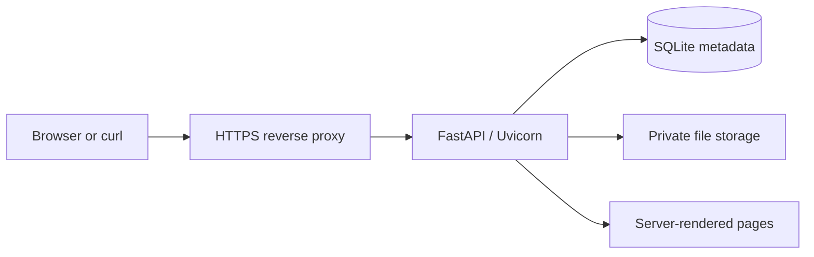

# Junkyard architecture

Status: approved by the project owner on 2026-11-07. Milestone 1 is committed. Milestone 2 is implemented and awaiting review; later milestones have not started.

This design builds on [requirements.md](requirements.md). Development milestones and acceptance criteria are in [implementation-plan.md](implementation-plan.md).

## Agreed behavior

- One administrator; publicly readable files accessible by possession of their links.
- Python with FastAPI, running on one Linux host behind an HTTPS reverse proxy.
- Local file storage with SQLite metadata.
- Separate passwords for browser administration and curl.
- HTTP Basic authentication for curl, supporting password prompts and protected configuration files.
- Random URL-safe IDs: **6 characters by default**, **32 characters when requested**.
- Files expire after 30 days by default; explicit lifetimes and permanent files are supported.
- Replacement preserves the link, filename, and expiration unless metadata changes are explicitly requested.
- Expiration blocks new requests immediately; active downloads may finish.
- Interrupted uploads restart. Downloads support byte ranges.
- Shared links automatically show a viewer in browsers and return bytes to curl.
- Anonymous requests are limited per IP to one per second, with a burst of ten.

Six-character links are **unlisted public links, not a confidentiality guarantee**. They provide 36 bits of randomness. Long links provide 192 bits and stronger resistance to guessing, but anyone possessing either kind can read the file. Neither kind appears in a public directory.

## Application architecture



### Runtime and dependencies

Use one Uvicorn worker, with bounded concurrent transfers. Run synchronous database and filesystem operations outside the async event loop. FastAPI supports the required [streaming responses](https://fastapi.tiangolo.com/advanced/custom-response/) and [Jinja2 templates](https://fastapi.tiangolo.com/advanced/templates/).

Direct runtime dependencies will be FastAPI, Uvicorn, Jinja2, and `argon2-cffi`. Use Python's `sqlite3` interface and explicit SQL, without an ORM. Use small amounts of browser JavaScript for file uploads, CSRF-protected requests, and copying share links. No frontend build system.

Organize code around HTTP handlers, authentication, file operations, persistence, and templates. Both browser and CLI handlers call the same file-operation functions. Avoid generic storage backends, plugin systems, or repository interfaces.

These dependencies provide established HTTP, templating, and password-hashing implementations. SQLite avoids custom metadata indexing and transaction logic; local blob storage keeps file transfers simple. A separate SPA or distributed service architecture is unnecessary for the intended workload.

### Persistence and concurrent access

SQLite stores file metadata, credential hashes, sessions, and a schema version. File records include the public ID, internal blob reference, display filename, size, timestamps, expiration, and revision.

- Generate internal storage names independently of supplied filenames and public IDs.
- Stream uploads into private temporary files on the same filesystem as final storage.
- Publish complete, immutable blobs before committing their metadata.
- Replace files by switching the database reference, never overwriting an active blob.
- Reject an update with `409 Conflict` if the target changed or disappeared during its upload.
- Pin blobs during downloads so replacement and cleanup cannot break an active response.
- Use short database transactions; never hold a transaction throughout a transfer.

A cleanup task is planned for milestone 3 and will run every minute. It will remove expired records and unreferenced blobs, deferring blobs used by active downloads. Startup reconciliation will remove abandoned uploads and check storage consistency. Missing referenced blobs produce an operational error, not silent metadata deletion.

Milestone 2 implements immutable publication, revision checks, download pins,
immediate best-effort removal of unreferenced blobs after normal operations, and
quota accounting for all staged and stored content. Startup counts crash
leftovers without deleting them. A filesystem lock enforces the single-worker
boundary. Existing credential-only databases upgrade through the explicit local
`junkyard migrate` command; new databases use schema version 2.

A filesystem operation and a database transaction do not commit atomically. Publishing immutable blobs before metadata, followed by reconciliation, gives this boundary an explicit failure model. The design accepts temporary extra disk usage to make interrupted uploads and replacements safe.

### Deployment

Provide a documented Nginx configuration and systemd service example. Run the application as an unprivileged account on a loopback address; only the proxy accepts public traffic.

Use a configured canonical public URL when generating links. Trust forwarded headers only from the configured proxy. The proxy must never serve the private storage directory directly.

## HTTP interfaces

Milestone 1 adds a read-only `GET /auth/check` endpoint for verifying CLI Basic
authentication before file operations exist. It returns `204` on success and a
generic `401` challenge on authentication failure. This endpoint accepts only the
CLI credential; it does not create a browser session. Milestone 2 implements file
creation, replacement, metadata edits, deletion, and basic attachment downloads.
The table below describes the final interface; HEAD/ranges remain milestone 3,
and HTML negotiation and previews remain milestone 4.

| Operation | Interface | Behavior |
|---|---|---|
| Create | `PUT /u/{filename}` | Store request body and generate a new link |
| Create without filename | `PUT /u` | Support stdin; use the ID as the fallback filename |
| Read | `GET /{id}` | HTML viewer when explicitly accepted; otherwise bytes |
| Inspect headers | `HEAD /{id}` | Match the selected GET representation without its body |
| Raw content | `GET /{id}/raw` | Always bytes; safe media may render inline |
| Download | `GET /{id}/download` | Always an attachment with a sanitized filename |
| Replace | `PUT /{id}` | Atomically replace contents |
| Edit metadata | `PATCH /{id}` | Change filename or expiration without re-uploading |
| Delete | `DELETE /{id}` | Immediately deny subsequent reads and schedule cleanup |

All CLI mutations require Basic authentication. Browser administration uses separate `/admin/` routes with session and CSRF checks; cookies do not authorize CLI mutation routes.

Parameters:

- `s=1`: generate a long link, creation only.
- `e=30d`: lifetime; accept positive integer durations with `h` or `d`.
- `e=0`: never expire.
- `name=...`: explicit display filename on creation or modification.

Creation defaults to 30 days from successful publication. An explicit expiration update counts from the successful update; omission preserves the existing deadline. Expired files cannot be revived through modification.

Creation returns `201 Created`, a `Location` header, and the shared URL followed by a newline. Successful updates return the same URL; deletion returns `204`. Clients requesting JSON receive metadata instead of the plain URL. Errors use structured JSON for headless clients and HTML for viewer requests.

Example commands:

```sh
curl -u admin -T photo.jpg https://example.com/u/
curl -u admin -T photo.jpg 'https://example.com/u/photo.jpg?s=1&e=7d'
curl -u admin -T replacement.jpg https://example.com/ID
curl -u admin -X PATCH 'https://example.com/ID?e=0'
curl -u admin -X DELETE https://example.com/ID
```

The curl integration test confirms that curl appends the local filename when the
upload URL ends with `/` and has no query string. With query parameters, provide
the filename explicitly in the path or through `name=`; otherwise the generated
ID becomes the display name. The supplied name is display metadata, never a
storage path. A protected, service-specific curl configuration file supports
unattended use. See the [curl documentation](https://curl.se/docs/manpage.html).

The proposed secret-header-name authentication is replaced by Basic authentication. curl treats `-H 'secretkey:'` as removing that header, header names are case-insensitive, and secret header names may escape credential redaction in logs.

## Viewer and admin pages

The viewer displays the ID, filename, size, creation/modification timestamps, expiration, preview, download button, and share button.

Preview escaped text, common raster images, and browser-supported audio/video. Limit text previews to 256 KiB with a truncation notice. HTML, SVG, PDF, and unsupported formats download as attachments. Never trust a supplied content type to enable active content.

The admin panel provides a paginated file list, storage usage, upload/replacement, filename and expiration editing, deletion, and CLI-password rotation. Changing a file's link type requires creating a new upload and deleting the old one; v1 has no aliases or multiple links per file.

Automatic browser-versus-curl responses use `Accept` negotiation, not user-agent detection. Explicit raw and download routes provide predictable alternatives. Restricted previews avoid executing uploaded active content on the admin application's origin.

## Security and operational defaults

The following are approved defaults, configurable where appropriate:

- **Limits:** 250 MiB per file, 100 GiB storage quota, and four simultaneous transfers. Count temporary uploads and obsolete blobs toward disk usage; reject excess work cleanly.
- **Credentials:** salted Argon2id hashes; passwords never expire automatically. Local administrative commands initialize and reset credentials through hidden prompts. No default password or public setup endpoint. See [OWASP password-storage guidance](https://cheatsheetseries.owasp.org/cheatsheets/Password_Storage_Cheat_Sheet.html).
- **Sessions:** random opaque tokens, hashed in SQLite; `Secure`, `HttpOnly`, host-only cookies with `SameSite=Strict`. One-hour idle timeout and 12-hour absolute lifetime. Browser-password changes revoke all browser sessions; CLI-password changes invalidate only the old CLI credential.
- **CSRF:** tokens and origin checks for browser mutations, including login protection. Require the browser password again before rotating the CLI password.
- **Authentication throttling:** separate limits for failed login/Basic authentication, plus bounded password-verification concurrency. Anonymous throttling applies to file/viewer requests, including HEAD; fixed application assets are exempt. Return `429` with `Retry-After`.
- **Path safety:** validate ID syntax; reject traversal, separators, control characters, and malformed filename encoding. Treat filenames strictly as metadata. Keep storage private and refuse symlink-based access.
- **Content safety:** escaped templates, restrictive CSP, `nosniff`, and no third-party assets. Disable cross-origin API access.
- **Privacy:** `Cache-Control: no-store`, `Vary: Accept` on negotiated responses, and `Referrer-Policy: no-referrer`. Unknown, expired, and deleted links return the same public `404`.
- **Logs:** record operation, status, duration, and internal correlation identifiers; omit passwords, cookies, filenames, and shared URLs from application and proxy access logs.
- **Recovery:** provide an offline backup/restore procedure covering both SQLite and blobs. Deletion and expiration do not erase existing backups or previously downloaded copies.

Rate-limit state stays bounded in memory and resets on restart. This is an explicit single-worker design; multiple application workers would require revisiting coordination. The burst allowance accommodates page loads and media requests, but per-IP throttling does not prevent distributed guessing and may affect users sharing an IP.

## V1 boundaries

V1 excludes resumable uploads, multiple administrators, reader accounts, version history, deduplication, transcoding, public search, and distributed storage. All originally requested browser functionality remains included.
